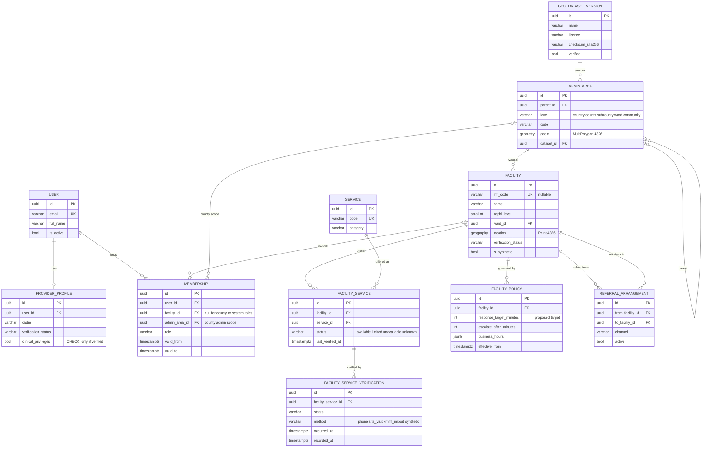
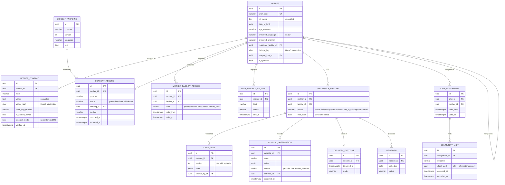
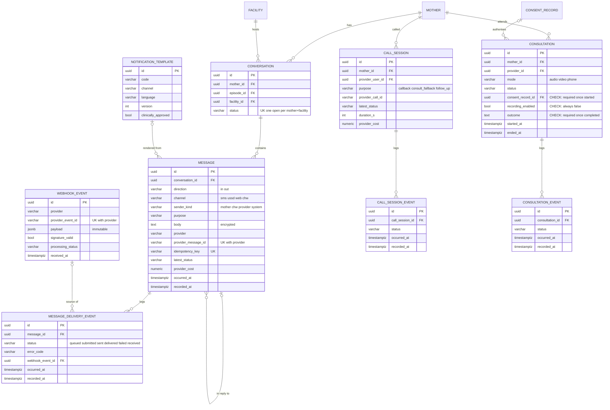
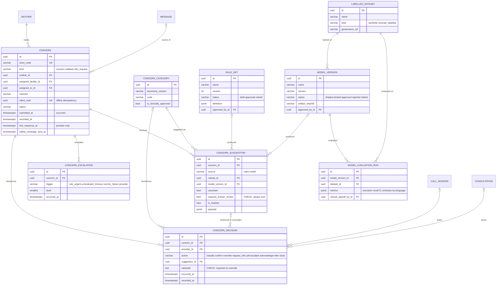
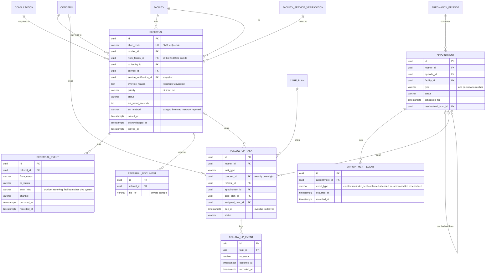

# Reach Database Design Specification (DDS)

**Version 0.1, Phase 2 rebuild (Django 5.2 LTS / GeoDjango / PostgreSQL + PostGIS)**
**Test geography:** Nairobi City County (synthetic data only)
**Status:** Draft for review. Nothing here is clinically approved. Every facility service row and every mother in the seed data is synthetic.

How to read this: the Django models in `reach/apps/*/models.py` are the field-level source of truth. This document holds what models cannot say well: the ERDs, the reasoning, the state machines, the privacy map, the DB roles, and the seed plan. Each decision is tagged:

- **[D]** a deliberate design decision. Changing it later is expensive, so challenge it now.
- **[J]** a judgment call. Reasonable people differ, and it may need revisiting at hardening.

---

## 1. Stack and versions

| Layer | Choice |
|---|---|
| Python / Django | 3.12+ / Django 5.2 LTS (`CheckConstraint(condition=...)`, `db_default`, `UniqueConstraint(nulls_distinct=...)`) |
| Database | PostgreSQL 16 or 17, PostGIS 3.4+ |
| Spatial | `django.contrib.gis`, SRID 4326 storage |
| Append-only enforcement | `django-pgtrigger` |
| Field encryption | `cryptography` (Fernet / MultiFernet for key rotation) |
| Async work | Celery + Redis (webhook processing, retries, escalation timers) |
| API | Django REST Framework |
| AI service | Separate FastAPI service, called over an authenticated API (not in this schema) |

---

## 2. Design decisions

| # | Type | Decision |
|---|---|---|
| D-01 | J | **UUIDv7 primary keys**, generated in the app (`core.ids.uuid7`). Time-ordered, so inserts stay index-local on the big event tables, and IDs are not guessable. |
| D-02 | D | **`timestamptz` everywhere.** Every event row has `occurred_at` (when it happened per the provider or device) and `recorded_at` (server time, `db_default=Now()`, set by the database, never the client). Offline CHW sync stays honest because of this split. |
| D-03 | D | **Append-only tables are enforced by Postgres triggers**, not convention. Corrections are new rows that point at what they correct. The app role also lacks UPDATE/DELETE/TRUNCATE grants on these tables (section 6). |
| D-04 | J | **Denormalised current status** (`Referral.status`, `Message.latest_status`, `Concern.status`, and so on) is updated in the same transaction as the event insert. A test asserts the denormalised value always equals the value derived from the latest event. |
| D-05 | J | **Facility-scoped access** via `Membership(user, facility, role)` plus `MotherFacilityAccess` (time-boxed grants). Scoped managers now (`Mother.objects.visible_to(user)`). Postgres Row-Level Security is revisited at hardening, because it fights connection pooling. |
| D-06 | J | **Field-level encryption** for mother name, contact values and message bodies, with HMAC blind indexes where lookup is needed (inbound SMS sender). Disk and backup encryption are assumed on top of this. |
| D-07 | D | **Exact household coordinates live in their own table** (`MotherExactLocation`) behind a separate DB role. Analysis and dashboards use `MotherLocation`, which holds ward plus a grid-snapped point. A dashboard bug cannot leak a household, because the dashboard role cannot read the table. |
| D-08 | D | **A callback request is a `Concern` with `kind='callback'`.** It enters the same review queue and counts toward the same response-time KPI. There is no separate callback table. |
| D-09 | D | **"Overdue" is derived, not stored.** A task is overdue when it is open and `due_at < now()`. A stored status goes stale, and an overdue flag is operational, never clinical. |
| D-10 | D | **Suggestion and decision are separate tables.** `ConcernSuggestion` (rules or model) never touches clinical records. `ConcernDecision` is the only thing that does. |
| D-11 | D | **`first_response_at` excludes automated messages**, including the automatic safety instruction sent for urgent concerns. Only a provider decision or a provider-sent message counts. Otherwise the four-hour target measures the system's own auto-reply. |
| D-12 | D | **Consent is append-only**, current state is a view, and the DB refuses to start a consultation without a consent record (CHECK). |
| D-13 | D | **A referral snapshots the facility-service verification it relied on.** Referring to an unverified destination is allowed (clinical judgment), but requires an `override_reason`. |
| D-14 | J | **Roles are code enums**, not rows. Permissions are defined in code and tested. Roles map to clinical governance, so they should change through review, not an admin screen. |
| D-15 | D | **`is_synthetic` on `Mother` and `Facility`.** Test data can never be confused with pilot data, and exports and dashboards filter on it. |
| D-16 | D | **No GenericForeignKey.** A follow-up task points at its origin through N nullable FKs plus a CHECK that exactly one is set. |
| D-17 | D | **The app graph is acyclic** (section 3). `Membership` lives in `facilities`; person-location tables live in `spatial`. This avoids circular migrations. |
| D-18 | D | **Store SRID 4326.** Use `geography` for distance queries. Analysis jobs reproject to **EPSG:32737** (WGS 84 / UTM 37S) for Nairobi. |
| D-19 | J | **No partitioning yet.** Message, audit and access logs are the candidates (monthly, via `pg_partman`) once volumes justify it. Django does not model partitions, so it needs raw migrations. |

---

## 3. App map and dependency order

```
core        UUIDv7, encrypted field, blind index, AppendOnlyModel
accounts    User, ProviderProfile
geo         GeoDatasetVersion, AdminArea
facilities  Facility, Service, FacilityService, FacilityServiceVerification,
            FacilityPolicy, ReferralArrangement, Membership
mothers     Mother, MotherContact, MotherFacilityAccess
consent     ConsentWording, ConsentRecord, DataSubjectRequest
care        PregnancyEpisode, CarePlan, ClinicalObservation, DeliveryOutcome, Newborn
ai          LabelledDataset, ModelVersion, ModelEvaluationRun
comms       Conversation, Message, MessageDeliveryEvent, WebhookEvent,
            NotificationTemplate, CallSession, CallSessionEvent,
            Consultation, ConsultationEvent
triage      ConcernCategory, RuleSet, Concern, ConcernSuggestion,
            ConcernDecision, ConcernEscalation
referrals   Referral, ReferralEvent, ReferralDocument
appointments Appointment, AppointmentEvent
followups   FollowUpTask, FollowUpEvent
chw         CHWAssignment, CommunityVisit
spatial     MotherLocation, MotherExactLocation, CatchmentArea, AccessibilityResult
audit       AuditLog, AccessLog, DataExport, SecurityIncident
```

Migration and dependency order (each app depends only on those above it):
`core, accounts, geo, facilities, mothers, consent, care, ai, comms, triage, referrals, appointments, followups, chw, spatial, audit`

Two edges are deliberately one-directional to keep this acyclic:

- `ConcernDecision` points at `CallSession` / `Consultation` (triage depends on comms), never the reverse.
- `Referral` points at `Concern` and `Consultation`. Neither points back at the referral. "Which referral came from this concern?" is a reverse query.

---

## 4. Entity-relationship diagrams

Key columns only. Full definitions are in the models.

### 4.1 Access, geography and facilities



### 4.2 Mothers, consent, care and community health



### 4.3 Communication and teleconsultation



### 4.4 Triage and AI



### 4.5 Care coordination: referrals, appointments, follow-up



### 4.6 Spatial analysis and governance

```mermaid
erDiagram
    MOTHER ||--o{ MOTHER_LOCATION : "located at"
    MOTHER ||--o| MOTHER_EXACT_LOCATION : "restricted"
    ADMIN_AREA ||--o{ MOTHER_LOCATION : contains
    CONSENT_RECORD |o--o{ MOTHER_LOCATION : "basis"
    FACILITY ||--o{ CATCHMENT_AREA : serves
    FACILITY ||--o{ ACCESSIBILITY_RESULT : "reached from"
    ADMIN_AREA ||--o{ ACCESSIBILITY_RESULT : "origin"
    GEO_DATASET_VERSION ||--o{ CATCHMENT_AREA : "built from"
    USER ||--o{ AUDIT_LOG : acts
    MOTHER |o--o{ ACCESS_LOG : "viewed"
    USER ||--o{ DATA_EXPORT : exports

    MOTHER_LOCATION {
        uuid id PK
        uuid mother_id FK
        varchar precision "county subcounty ward community grid"
        uuid admin_area_id FK
        geography grid_point "snapped to ~500m"
        varchar purpose
        uuid consent_record_id FK
        timestamptz occurred_at
        timestamptz recorded_at
    }
    MOTHER_EXACT_LOCATION {
        uuid id PK
        uuid mother_id FK
        geography point "restricted DB role only"
        uuid consent_record_id FK
        timestamptz occurred_at
    }
    CATCHMENT_AREA {
        uuid id PK
        uuid facility_id FK
        varchar kind "admin service_area isochrone"
        varchar travel_mode
        int threshold_minutes
        geometry geom "MultiPolygon 4326"
        jsonb assumptions
        uuid dataset_id FK
    }
    ACCESSIBILITY_RESULT {
        uuid id PK
        uuid origin_area_id FK
        uuid facility_id FK
        varchar method "straight_line road_network"
        int distance_m
        int travel_seconds
        bool is_estimate "always true"
        uuid dataset_id FK
    }
    AUDIT_LOG {
        uuid id PK
        uuid actor_id FK
        varchar action
        varchar object_type
        varchar object_id
        jsonb changes "redacted"
        inet ip
        timestamptz occurred_at
    }
    ACCESS_LOG {
        uuid id PK
        uuid actor_id FK
        uuid mother_id FK
        varchar resource
        varchar purpose
        timestamptz occurred_at
    }
    DATA_EXPORT {
        uuid id PK
        uuid actor_id FK
        varchar kind
        jsonb scope
        int row_count
        bool small_cell_suppressed
    }
    SECURITY_INCIDENT {
        uuid id PK
        varchar severity
        varchar status
        timestamptz detected_at
        timestamptz notified_odpc_at
    }
```



---

## 5. Constraint catalogue (rules the database itself enforces)

| Table | Constraint | Rule it encodes |
|---|---|---|
| `Membership` | CHECK + unique (`nulls_distinct=False`) | Facility required except for county or system roles; county admin requires `admin_area`; no duplicate (user, facility, role) |
| `ProviderProfile` | CHECK | `clinical_privileges` only when `verification_status='verified'` |
| `AdminArea` | unique (level, code); CHECK | Only the country level may lack a parent |
| `Facility` | unique `mfl_code` | KMHFL identifier is unique where present |
| `FacilityService` | unique (facility, service) | One current row per pair; history lives in verifications |
| `ReferralArrangement` | CHECK, unique | `from != to`; one arrangement per pair |
| `Mother` | CHECK | Either DOB or age estimate is present |
| `MotherContact` | partial unique | One active primary phone per mother |
| `PregnancyEpisode` | partial unique `WHERE status='active'` | One active pregnancy per mother; closed status requires `closed_at` |
| `CarePlan` | unique (episode, version) | Versions never collide |
| `Message` | partial unique (provider, provider_message_id); partial unique `idempotency_key` | A duplicate webhook or an offline resubmission fails at the database |
| `WebhookEvent` | unique (provider, provider_event_id); trigger | Replay-safe; raw payload immutable |
| `Conversation` | partial unique `WHERE status='open'` | One open conversation per mother per facility |
| `Consultation` | CHECK x3 | `recording_enabled=false`; consent required once started; outcome required once completed |
| `Concern` | CHECK; partial unique `client_uuid` | `first_response_at >= submitted_at`; offline replay is idempotent |
| `ConcernSuggestion` | CHECK x2 | Exactly one of `ruleset` / `model_version` matching `source`; `requires_human_review` always true |
| `ConcernDecision` | CHECK x2 | Override requires rationale; confirm or override requires a suggestion |
| `Referral` | CHECK x3 | `from != to`; estimate fields all-or-none; unverified destination requires `override_reason` |
| `FollowUpTask` | CHECK | Exactly one origin FK is set (D-16) |
| `ConsentRecord`, all `*Event`, `AuditLog`, `AccessLog`, `DataExport`, `CommunityVisit`, `CarePlan`, `ClinicalObservation` | trigger | Insert-only |

Two rules cannot be expressed as a CHECK, because Django has no composite foreign keys: "a decision's `suggestion` belongs to the same concern" and "a referral's `service_verification` belongs to the referral's `service` and `to_facility`". Both are enforced in `services.py` and backed by a **constraint trigger** added in a `RunSQL` migration (listed in section 13).

---

## 6. Append-only enforcement

Three layers:

1. **Trigger** (`pgtrigger.Protect`) raises on UPDATE or DELETE. It is inherited from `AppendOnlyModel`. Child `Meta` classes must subclass `AppendOnlyModel.Meta` to keep it.
2. **Privileges:** the `reach_app` role gets only `INSERT, SELECT` on these tables, and `TRUNCATE` is never granted.
3. **Corrections** are new rows (`corrects_id` on observations; a new `ConsentRecord` with `status='withdrawn'`; a new `FacilityPolicy` row).

`WebhookEvent` is mixed: its payload columns are `ReadOnly` (trigger), its processing columns (`processing_status`, `attempts`, `last_error`) stay mutable, and DELETE is blocked.

---

## 7. State machines (enforced in `services.py`, one transition map per module)

**Referral:** `draft -> issued -> sent -> acknowledged -> arrived -> under_assessment -> completed`
Side exits: `cancelled` (from `issued`, `sent`, `acknowledged`); `declined` (from `sent`, `acknowledged`); `unresolved` (from `sent`, `acknowledged`, set by a timeout job); `unresolved -> acknowledged | arrived | completed | cancelled` when late information arrives. Terminal: `completed`, `cancelled`, `declined`. A declined referral is replaced by a new referral, not edited.

**Concern:** `open -> in_review | awaiting_info | actioned | closed`; `in_review -> awaiting_info | actioned | closed`; `awaiting_info -> in_review | actioned | closed`; `actioned -> closed | in_review`. Terminal: `closed`.

**Appointment:** `scheduled -> confirmed | attended | missed | cancelled | rescheduled`; `confirmed -> attended | missed | cancelled | rescheduled`. All others terminal. A missed appointment spawns a `FollowUpTask`, and never a "non-compliant" label.

**Consultation:** `scheduled -> initiated -> waiting -> in_progress -> completed`, with `failed` and `cancelled` as exits from any pre-completion state.

**Follow-up task:** `pending -> assigned -> in_progress -> completed | unable | cancelled`; `unable -> pending` (retry). **Overdue is derived (D-09).**

**Message (outbound):** `created -> queued -> submitted -> sent -> delivered | failed`. Inbound: `received`. Webhooks arrive out of order, so `latest_status` advances by status **rank**, not arrival order. A late `sent` cannot overwrite `delivered`.

---

## 8. Index strategy

- **GiST** (automatic): `Facility.location`, `AdminArea.geom`, `CatchmentArea.geom`, `MotherLocation.grid_point`.
- **Review queue:** `Concern(assigned_facility, status, submitted_at)` as a partial index `WHERE status IN ('open','in_review','awaiting_info')`.
- **Delivery workers:** `Message(latest_status, recorded_at)` partial `WHERE latest_status IN ('created','queued','submitted','failed')`.
- **Inbound SMS lookup:** `MotherContact(value_hash)`.
- **Dedupe:** `Mother(dedupe_key)`.
- **Timelines:** `(mother, occurred_at DESC)` on `Message`, `Concern`, `ConsentRecord`; `(episode, scheduled_for)` on `Appointment`.
- **Overdue sweep:** `FollowUpTask(due_at)` partial `WHERE status IN ('pending','assigned','in_progress')`.
- **Events:** `(parent_id, occurred_at)` on every `*Event` table.
- **Consent current state:** `(mother, purpose, occurred_at DESC)`.

---

## 9. KPI derivation

The primary indicator is the time from concern submission to the first documented provider response. Delivery and review are separate facts that live in separate tables.

```sql
-- Response time per concern. first_response_at is set in the same transaction as the
-- first provider ConcernDecision or provider-sent Message (D-11: automated messages excluded).
CREATE MATERIALIZED VIEW rpt_concern_response AS
SELECT c.id,
       c.assigned_facility_id,
       c.submitted_at,
       c.first_response_at,
       EXTRACT(EPOCH FROM (c.first_response_at - c.submitted_at)) AS response_seconds,
       (c.first_response_at - c.submitted_at)
           <= make_interval(mins => fp.response_target_minutes)       AS within_target
FROM triage_concern c
JOIN LATERAL (
    SELECT response_target_minutes
    FROM facilities_facilitypolicy p
    WHERE p.facility_id = c.assigned_facility_id AND p.effective_from <= c.submitted_at
    ORDER BY p.effective_from DESC LIMIT 1
) fp ON TRUE;
```

The response target comes from `FacilityPolicy` (agreed per facility, including hours and exclusions), not a global constant. It is a proposed pilot target, never an achieved result.

County dashboards read only from aggregate views with **small-cell suppression** (cells with fewer than 5 mothers are withheld). Those views are owned by the analyst role, which has no access to the base tables.

---

## 10. PII and encryption map

| Data | Where | Treatment |
|---|---|---|
| Mother name | `Mother.full_name` | Field-encrypted. Lookup via `dedupe_key` (HMAC of normalised name + DOB) |
| Phone and emergency contact | `MotherContact.value` | Field-encrypted + `value_hash` blind index; `hash_key_version` supports key rotation |
| Message body | `Message.body` | Field-encrypted; never written to application logs |
| Exact household coordinates | `MotherExactLocation.point` | Separate table, separate DB role, no GiST index for the app role |
| Ward and grid point | `MotherLocation` | Used for dashboards and analysis; grid-snapped to about 500 m |
| Clinical data | `care.*` | Role-scoped; CHWs see a restricted serializer, never the raw record |
| Audit and access logs | `audit.*` | Redacted diffs; insert-only |
| Raw webhook payloads | `WebhookEvent.payload` | Contains MSISDNs, so restricted role and retention-limited |

Notification content for `discreet_mode` contacts carries no clinical content, only an instruction to call the facility.

---

## 11. Postgres roles

| Role | Privileges |
|---|---|
| `reach_migrator` | DDL; used only by deploys |
| `reach_app` | DML on mutable tables; `INSERT, SELECT` only on append-only tables; no access to `MotherExactLocation` except through a `SECURITY DEFINER` function that writes to the audit log |
| `reach_worker` | As `reach_app`, plus read on `WebhookEvent` payloads |
| `reach_gis` | Read on `Facility`, `AdminArea`, `MotherLocation`; write on `CatchmentArea`, `AccessibilityResult`. No identity tables |
| `reach_analyst` | Read-only on `rpt_*` aggregate views; no base-table access |

---

## 12. Nairobi seed plan (synthetic)

**Geography.** Nairobi City County is county code 047 in the national scheme. Expect 17 constituencies (used as sub-counties) and 85 wards, but confirm counts and names against the boundary file you actually download, because boundary revisions happen. Candidate sources: IEBC or KNBS boundaries, or a humanitarian boundary mirror. Record each in `GeoDatasetVersion` with licence and checksum, and set `verified=False` until you have checked it.

**Facilities.** Import Nairobi rows from the Kenya Master Health Facility List (KMHFL) into `Facility` (with `mfl_code`, `kephl_level`, coordinates), filtered to those with maternity-relevant services. Real facility names are fine, but **the `FacilityService` rows and their verifications are synthetic**: `method='synthetic'`, `Facility.is_synthetic=True`. They are test data and must never be shown as verified service availability. Seed 10 to 15 facilities across levels 3 to 6 so referral routing has real choices (a health centre referring up to a sub-county or county referral hospital).

**Mothers.** About 30 synthetic mothers, `is_synthetic=True`, spread across wards, with `MotherLocation` at ward precision plus a grid point. Phone numbers must be clearly non-routable, and the SMS gateway must run in its sandbox, so a test can never message a real person.

**Roads.** Road-network accessibility uses an OpenStreetMap extract for Nairobi, routed with OSRM, Valhalla or pgRouting. Every result is stored with `is_estimate=True` and its `method`. Never present it as an actual journey time.

**Command:** `python manage.py seed_nairobi --facilities N --mothers 30`, idempotent and refusing to run when `DEBUG=False` and a non-synthetic row exists.

---

## 13. Migration plan and required tests

Migration order is in section 3. Hand-written migrations (`RunSQL`):

1. `CREATE EXTENSION postgis; CREATE EXTENSION pgcrypto;` (before `geo`)
2. `consent_current` view (`DISTINCT ON (mother_id, purpose) ... ORDER BY occurred_at DESC, id DESC`)
3. Constraint triggers for the two cross-row rules in section 5
4. `rpt_*` materialised views and the `reach_*` role grants

Tests that must exist before the schema is considered done:

- **Cross-facility leakage:** a clinician at Facility A never sees Facility B's mothers, through any endpoint or queryset.
- **Append-only:** UPDATE and DELETE raise on every protected table.
- **Idempotency:** replaying a webhook and re-syncing an offline batch create no duplicates.
- **Status divergence:** the denormalised status always equals the status derived from events (D-04).
- **Status ordering:** an out-of-order `sent` after `delivered` leaves `delivered`.
- **Referral transitions:** every illegal transition is rejected.
- **Consent gate:** an outbound send without consent is refused, and a consultation cannot start without it.
- **Single active pregnancy:** the partial unique index holds under concurrent inserts.
- **First-response rule:** an automated safety message does not set `first_response_at`.
- **Small-cell suppression:** aggregate views withhold cells below the threshold.

---

## 14. Open judgment calls to confirm

1. **D-06 encryption scope.** I encrypt name, contact values and message bodies. If you want clinical free text encrypted too (`ConcernDecision.rationale`, `Consultation.outcome`), say so before the first migration, because it is painful afterward.
2. **D-05 RLS.** Scoped managers now, RLS at hardening. If your hosting uses a pooler in transaction mode, RLS needs `SET LOCAL` per transaction.
3. **D-04 denormalised status.** Kept, with the divergence test. The alternative (derive every time) is purer but slows list views.
4. **Referral transition trigger.** I enforce transitions in services only. A DB trigger would be stronger, at the cost of duplicating the transition map in SQL.

---

## 15. Traceability to the SRS

| SRS modules | Apps |
|---|---|
| 01 User management, 04 Providers | `accounts`, `facilities` (Membership) |
| 02 Maternal profiles, 16 Consent | `mothers`, `consent` |
| 03 Pregnancy and care | `care` |
| 05 Facilities | `facilities` |
| 06 CHW | `chw` |
| 07 Communication, 08 Teleconsultation | `comms` |
| 09 Clinical review and triage, 14 AI | `triage`, `ai` |
| 10 Appointments | `appointments` |
| 11 Referrals | `referrals` |
| 12 Follow-up | `followups` |
| 13 GIS | `geo`, `spatial` |
| 15 Reporting | `rpt_*` views (section 9) |
| 16 Audit | `audit` |

SRS deviations: `prediction_reviews` is replaced by `ConcernDecision.suggestion` (agreement is a query, not a table); `CallbackRequest` is replaced by `Concern(kind='callback')` (D-08); "overdue" status is derived (D-09); `FacilityPolicy` is added so the response target is defined per facility.
